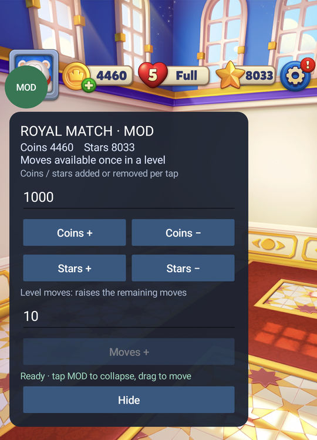

# Royal Match MOD

> **Package: `com.dreamgames.royalmatch`** · **Supported version: `38174`**
>
> Class, field and method names in the script come from this build's metadata. Re-check the interfaces before running it against a different build.

A mod menu for Royal Match: set your coins and stars, and add extra moves during a level.



## What it does

An overlay menu attached to a running Royal Match process with Frida. Three things:

- **Coins** — add or remove any amount, through the game's own update method, with the HUD refreshed.
- **Stars** — the same.
- **Moves** — extra moves for the level you're currently playing.

Values are read live, and the panel shows the before and after of every action, e.g. `7033 → 8033`.

The menu attaches to the game's own Activity, so it needs no overlay permission.

## Files

| File | Purpose |
|---|---|
| `royal_mod.js` | The script. Every dependency is bundled — inject it and it runs. |
| `run_menu.py` | Launcher: picks the device, forwards the port, attaches the script. |
| `screenshots/mod_menu.png` | The screenshot above, from a real device. |

## Setup

You need a rooted Android phone and a computer.

### Phone

1. Root with Magisk, then confirm `su` works:

   ```
   adb shell su -c id
   ```

   `uid=0` means you're rooted.

2. Install frida-server. Grab the build for your phone's architecture from the
   [frida releases](https://github.com/frida/frida/releases) — recent phones want
   `frida-server-<version>-android-arm64`. Push it and start it as root:

   ```
   adb push frida-server-<version>-android-arm64 /data/local/tmp/
   adb shell su -c "chmod 755 /data/local/tmp/frida-server-<version>-android-arm64"
   adb shell su -c "/data/local/tmp/frida-server-<version>-android-arm64 &"
   ```

   Royal Match looks for frida-server's stock fingerprints — its process name and its default
   port. **Florida** is built from the same source with those changed, so use Florida and swap the
   filename in the commands above.

3. Note which port it listens on — this varies between builds:

   ```
   adb shell su -c "cat /proc/net/tcp" | awk '$4=="0A"{split($2,a,":"); print a[2]}'
   ```

   The output is hex: `69AF` is `27055`.

### Computer

1. Install [Android platform-tools](https://developer.android.com/tools/releases/platform-tools)
   and put `platform-tools` on your PATH.
2. Install frida for Python:

   ```
   pip install frida
   ```

3. Check the phone is authorized:

   ```
   adb devices -l
   ```

   You want a status of `device`.

## Usage

1. Open Royal Match on the phone and get to the main screen.
2. Run the launcher:

   ```
   python run_menu.py
   ```

   With more than one device attached, pass the serial:

   ```
   python run_menu.py --serial <device-serial>
   ```

3. Tap the green **MOD** button in the top-left to open the panel; tap again to collapse it.
   Drag to move it.
4. Change values:
   - Put the amount you want per tap into the **Coins / stars** box (default `1000`), then tap
     `Coins +`, `Coins −`, `Stars +` or `Stars −`.
   - Put the number of moves into the **Level moves** box (default `10`), then tap `Moves +`.
   - `Moves +` only works once you're in a level.
5. To stop, press `Ctrl+C` in the terminal. The menu goes away with the session.

Coins and stars survive a cold restart of the game. Moves apply to the level you're in.

## Contact

Questions, bugs and ideas: **nam9h33z@anonaddy.me**
